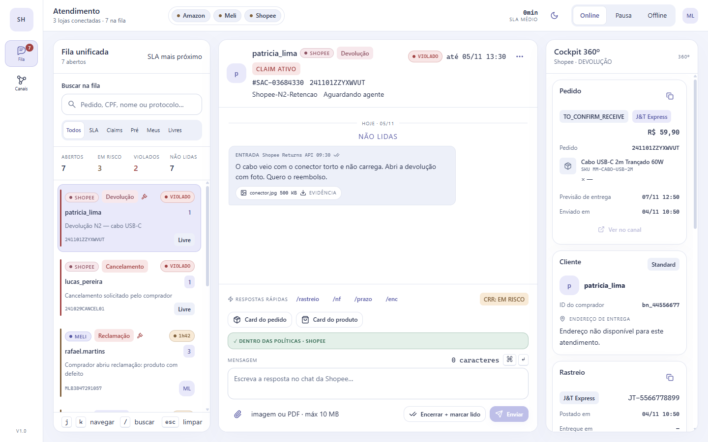
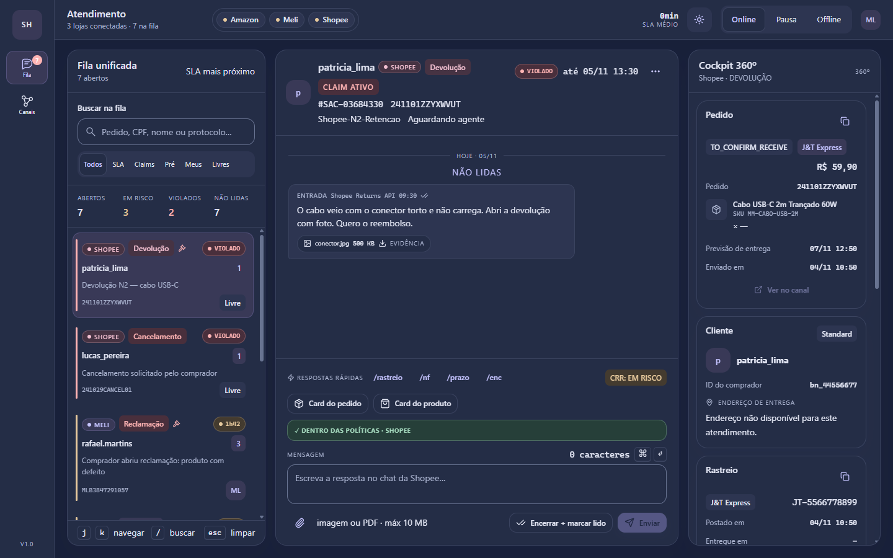
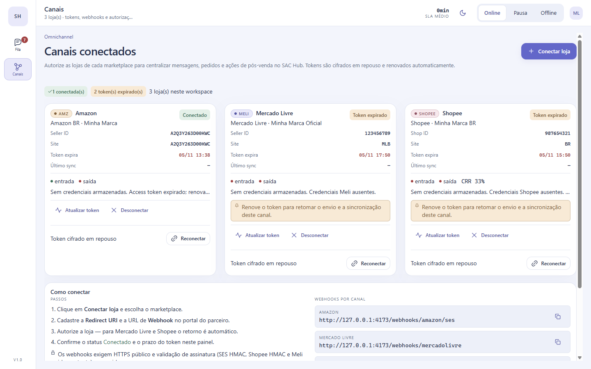
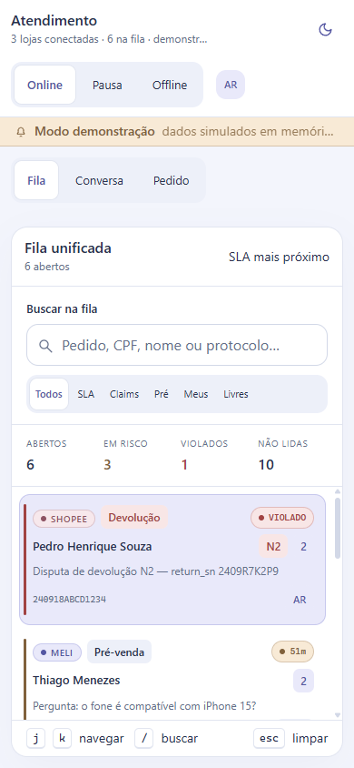
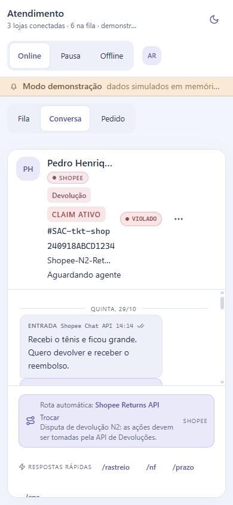

# SAC Hub — Integrador Omnichannel de Atendimento

[](https://integrai-dev.vercel.app)
[](https://github.com/xploryngDAO/IntegrAI)
[](docs/CONVERGENCIA_ADOPTION.md)
[](https://github.com/xploryngDAO/IntegrAI/actions/workflows/ci.yml)
[](https://github.com/xploryngDAO/IntegrAI/actions/workflows/security.yml)

> **Status:** integrações 100% reais — **sem modo demonstração e sem dados
> simulados**. O sistema opera apenas com credenciais reais dos marketplaces.
> **Código:** <https://github.com/xploryngDAO/IntegrAI>.
> **Setup de produção:** [docs/SETUP_PRODUCTION.md](docs/SETUP_PRODUCTION.md) ·
> **Validação das integrações:** [docs/INTEGRATION_VALIDATION.md](docs/INTEGRATION_VALIDATION.md)

Plataforma de SAC unificada para **Amazon (SP-API + SES)**, **Mercado Livre (API oficial)** e
**Shopee (Open Platform v2)**, construída como sistema **event-driven** com
**Hexagonal / Ports & Adapters**: webhooks respondem em milissegundos, o trabalho
pesado roda em filas BullMQ com backoff exponencial + jitter e DLQ, e o operador
trabalha numa única tela de 3 colunas com guardrails de política por canal.

```
┌───────────────────────────── Single Pane of Glass ─────────────────────────────┐
│ Telemetria │ Fila por SLA │ Chat + Composer adaptativo │ Cockpit 360º + Ações  │
└───────────────────────────────────┬────────────────────────────────────────────┘
              REST /api/v1 + Socket.IO  │
┌───────────────────────────────────▼────────────────────────────────────────────┐
│ Fastify 5 · JWT · zod · multipart                                              │
│  ┌───────────────┐  ┌──────────────────┐  ┌─────────────────────────────────┐  │
│  │ Controllers   │→ │ Application Core │→ │ Channel Adapters (Strategy)     │  │
│  │ webhooks/REST │  │ Tickets · SLA    │  │ Amazon · Mercado Livre · Shopee │  │
│  └───────────────┘  │ Outbound Router  │  └─────────────────────────────────┘  │
│                     └────────┬─────────┘                                       │
│  BullMQ workers + schedulers  │  Prisma · Redis (cache/lock/idempotência)     │
└───────────────────────────────┴────────────────────────────────────────────────┘
                                │
        PostgreSQL 16 (JSONB) · Redis 7 · S3/MinIO (.eml, NF-e, evidências)
```

## Estado atual da publicação

| Item | Estado |
|---|---|
| **SPA** | <https://integrai-dev.vercel.app> — landing pública, login real, área do usuário e admin (sem mock) |
| **API real** | túnel HTTPS temporário do ambiente de setup (ver [DEPLOY_LOCAL_TUNNEL](docs/DEPLOY_LOCAL_TUNNEL.md)); Postgres, Redis e S3 ok |
| **Operador** | criado por `npm run db:seed` com ADMIN_EMAIL/ADMIN_PASSWORD (não versionado) |
| **Marketplaces** | Mercado Livre conectado (token real); Shopee e Amazon aguardando apps/credenciais — `/setup` mostra o que falta |
| **Admin** | visão geral, usuários (busca/paginação/CSV), convites (reenvio), sessões (revogação) e logs/CSV |
| **SSO** | OIDC/Microsoft Entra implementado e validado com IdP local; falta o App registration real |
| **Evidência E2E** | `node scripts/verify-live.mjs <url> <email> <senha>` em navegador limpo, além de `validate:live`, `test:live-2fa`, `test:live-sso`, `test:live-socket` e `isolation-test` |

> Estado detalhado, links, credenciais do ambiente, comandos e pendências:
> [docs/PRODUCT_STATUS.md](docs/PRODUCT_STATUS.md).
## Screenshots

Interface no **Convergência Design System** (tema claro canônico + escuro). As imagens abaixo usam dados ilustrativos de layout — **a aplicação não gera nem exibe dados simulados**; sem API/credenciais ela mostra a tela de login ou estado vazio real.

| Workspace 3 colunas | Tema escuro |
|---|---|
|  |  |

| Workspace 3 colunas (claro) | Canais conectados / onboarding |
|---|---|
|  |  |

| Mobile — fila | Mobile — conversa |
|---|---|
|  |  |

Antes da adoção do DS (identidade escura própria), para comparação:
[workspace anterior](screenshots/06-real-api.png) · [claim Meli anterior](screenshots/02-meli-claim.png) · [guardrail Amazon anterior](screenshots/03-amazon-policy-block.png).

## Publicação

| Destino | URL / configuração |
|---|---|
| **Frontend (Vercel)** | <https://integrai-dev.vercel.app> — projeto `integrai-dev` (scope `xploryngdaos-projects`), deploy automático a cada push em `main`. Exige `VITE_API_BASE_URL` apontando para a API pública |
| **GitHub** | <https://github.com/xploryngDAO/IntegrAI> (público, MIT) |
| Build na Vercel | `npm run build:shared && npm run build --workspace @sac/web` · output `apps/web/dist` · `vercel.json` na raiz |
| Backend (obrigatório) | `docker compose up -d --build` em VM/host com Docker (API :4000 + web :8080 + Postgres/Redis) — ver [SETUP_PRODUCTION](docs/SETUP_PRODUCTION.md) |
| Validação | `npm run doctor` (infra + credenciais reais por canal) |

A Vercel hospeda **somente o SPA**. O backend é um serviço long-running
(Fastify + workers BullMQ + Postgres + Redis + S3) e precisa de Docker/VM/Kubernetes;
sem ele, a UI mostra a tela de login e os endpoints retornam erro — **não há
fallback simulado**.

## Sumário

- [Stack](#stack)
- [Quick start](#quick-start)
- [Diagnóstico e validação das integrações](#diagnóstico-e-validação-das-integrações)
- [Como conectar cada marketplace](#como-conectar-cada-marketplace)
- [Estrutura do repositório](#estrutura-do-repositório)
- [Regras de ouro implementadas](#regras-de-ouro-implementadas)
- [API](#api)
- [Banco de dados](#banco-de-dados)
- [Operação: filas, DLQ e replay](#operação-filas-dlq-e-replay)
- [Segurança & LGPD/PII](#segurança--lgpd-pii)
- [Testes & verificação](#testes--verificação)
- [Roadmap técnico](#roadmap-técnico)

## Stack

| Camada | Tecnologia |
|---|---|
| Backend | Node.js 20+ · TypeScript strict · Fastify 5 · zod |
| Mensageria | Redis 7 + BullMQ 5 (backoff exponencial + jitter, DLQ, repeatable jobs) |
| Banco | PostgreSQL 16 + Prisma 6 (JSONB para metadados de canal) |
| Cache/Lock/Rate | Redis: cache de tokens LWA/RDT/OAuth, idempotência `SET NX EX`, Redlock quorum, token bucket em Lua |
| Storage | Amazon S3 / MinIO (`.eml` imutável, anexos, evidências) |
| Realtime | Socket.IO 4 (fila, chat, presença, saúde dos canais) |
| Frontend | React 18 · Vite 6 · TypeScript · **Convergência Design System** (`@xploryng/convergencia` v0.1.0, tokens + 60 componentes) · zustand · date-fns |
| Infra | Docker Compose (Postgres, Redis, Mailpit, MinIO opcional) |

## Design system

A UI não é uma identidade inventada: ela **adota o Convergência Design System**
([`xploryngDAO/convergencia-design-system`](https://github.com/xploryngDAO/convergencia-design-system)),
instalado como dependência real da release `v0.1.0` (tarball fixado no
`package.json` do workspace `@sac/web`). O app roda dentro do
`DesignSystemProvider` com tokens semânticos (`--cv-*`), tema **claro** canônico e
**escuro** persistido, componentes oficiais (Button, Card, Badge, Status, Dialog,
Stepper, SegmentedControl, SearchField, Timeline, Tooltip, Avatar…) e a
acessibilidade do DS (foco de 3px, alvos de 44px, `prefers-reduced-motion`).

O produto só acrescenta a **geometria** da operação (rail, três colunas, thread,
composer) e as cores de domínio dos marketplaces, sempre dentro das famílias de
tom do DS (Amazon = warning, Mercado Livre = accent, Shopee = rose). Nenhum hex
novo é declarado no produto.

- Contrato de adoção e regras: [`docs/CONVERGENCIA_ADOPTION.md`](docs/CONVERGENCIA_ADOPTION.md)
- Fundações do DS: `docs/foundations.md` no repositório do design system
- Tema: alternância na topbar (`sac.hub.theme` no `localStorage`)

## Quick start

### 1. Subir a infraestrutura

```bash
cp .env.example .env          # ajuste credenciais se quiser integrações reais
docker compose up -d          # postgres + redis + mailpit
# opcional: S3 local
docker compose --profile s3 up -d
```

> Se a porta 5432 já estiver em uso na sua máquina (Postgres instalado), defina
> `POSTGRES_HOST_PORT=55432` (e `REDIS_HOST_PORT=56379`, `WEB_HOST_PORT=58080`)
> no `.env` e atualize `DATABASE_URL`/`REDIS_URL` para as mesmas portas.

### 2. Banco, migrações e operador inicial

```bash
npm install
npm run prisma:generate
npm run prisma:migrate:deploy   # aplica prisma/migrations
ADMIN_EMAIL=voce@suaempresa.com.br ADMIN_PASSWORD='uma-senha-forte-12+' npm run db:seed
# cria apenas o operador ADMIN — nenhum dado de marketplace é semeado
```

### 3. Rodar

```bash
npm run dev        # API em :4000 + web em :5173 (proxy /api e /socket.io)
# ou
npm run build && docker compose up -d --build   # API :4000 + web :8080
```

A web app tem **apenas o modo real**: tela de login → API. Sem API, sem usuário e
sem lojas conectadas, o sistema mostra erro honesto — **não existe fallback
simulado**. Use o ADMIN criado no bootstrap e conecte as lojas em `/accounts`.

### 4. Verificar

```bash
curl http://localhost:4000/api/v1/health
curl -X POST http://localhost:4000/api/v1/auth/login \
  -H "content-type: application/json" \
  -d '{"email":"voce@suaempresa.com.br","password":"sua-senha"}'
npm run doctor   # infra + credenciais reais de cada canal
```

## Diagnóstico e validação das integrações

Não há simulação. Para provar que cada canal está funcional com as **suas**
credenciais, use o diagnóstico real:

```bash
npm run doctor                      # infra + todas as lojas conectadas
npm run doctor -- --account=<uuid>  # uma loja específica
```

Cada check executa uma chamada real (token exchange + leitura barata) e retorna
`ok | warn | fail | skipped`, latência e o que corrigir:

| Canal | O que é chamado de verdade |
|---|---|
| Amazon | LWA token exchange + `GET /sellers/v1/marketplaceParticipations` (+ RDT opcional) |
| Mercado Livre | refresh/token + `GET /users/me` + `GET /users/{id}` |
| Shopee | `POST /api/v2/shop/get_shop_info` assinado (+ lost push opcional) |
| Infra | Postgres, Redis e S3 |

O mesmo diagnóstico está disponível na UI (`/accounts` → *Testar conexão*) e na
API (`GET /api/v1/diagnostics` / `POST /api/v1/accounts/:id/diagnose`).

- Matriz completa do que foi validado: [docs/INTEGRATION_VALIDATION.md](docs/INTEGRATION_VALIDATION.md)
- Passo a passo de configuração: [docs/SETUP_PRODUCTION.md](docs/SETUP_PRODUCTION.md)

## Como conectar cada marketplace

A tela **`/accounts`** (avatar → *Conectar lojas*) lista os conectores e abre o
wizard. As mesmas operações existem na API:

| Canal | Modo | Passos |
|---|---|---|
| **Mercado Livre** | OAuth 2.0 | Crie o app no [DevCenter](https://developers.mercadolivre.com.br/), cadastre `MELI_CLIENT_ID/SECRET`, clique **Autorizar** (a API gera a URL de consentimento com `state` assinado e faz o exchange do `code`), registre o webhook `POST /webhooks/mercadolivre` |
| **Shopee** | OAuth 2.0 (assinado) | Configure `SHOPEE_PARTNER_ID/PARTNER_KEY`, gere a URL `auth_partner` assinada, exchange via `/api/v2/auth/token/get`, registre `POST /webhooks/shopee` no console |
| **Amazon** | LWA + SES inbound relay + SMTP relay | Informe `sellerId`, `marketplaceSiteId`, `refreshToken`, `smtp_sender_email` (verificado no Seller Central), `inbound_email_route`; aponte o SES Inbound (ou SendGrid Inbound Parse) para `POST /webhooks/amazon/ses` com HMAC `x-sac-signature` |

URLs de webhook exibidas no wizard:
`/webhooks/mercadolivre`, `/webhooks/shopee`, `/webhooks/amazon/ses`.

> **Amazon:** o blueprint proíbe IMAP/polling. O ingresso é sempre por relay HTTP
> do e-mail bruto, persistido como `.eml` no S3 antes de entrar na fila.

## Estrutura do repositório

```
prisma/
  schema.prisma                 modelo unificado (5 tabelas centrais + 5 de apoio)
  migrations/20251105000000_init/migration.sql
  seed.ts                       bootstrap do operador ADMIN (sem dados fake)
packages/shared/src/            @sac/shared — contrato congelado
  enums.ts dto.ts adapter.ts constants.ts compliance.ts errors.ts
  ports/infra.ts ports/repositories.ts ports/services.ts
packages/server/src/
  config/                       env (zod) → AppConfig
  infrastructure/               prisma, redis cache, Redlock, token bucket, S3, AES-256-GCM, fetch, BullMQ
  application/repositories/     implementações Prisma das portas
  application/mappers/          record → view (fila, detalhe, pedido, mensagem)
  application/sla/              SlaEngine (prazos, prioridade, fila, breach)
  application/                  UnifiedTicketService, OutboundRouterService, WebhookIngress,
                                TicketQuery, Account, Agent, File, Health + workers
  adapters/amazon/              LWA · RDT · SES relay · thread MIME · SMTP relay · SP-API uploads
  adapters/mercadolivre/        OAuth rotativo · questions · packs · claims · attachments
  adapters/shopee/              HMAC-SHA256 · refresh single-use com Redlock · chat · returns · CRR
  http/                         Fastify app, rotas, controllers, middleware, Socket.IO
  queues/                       producers, workers, schedulers, DLQ
apps/web/src/
  lib/                          api client real, store zustand, labels, tema
  components/ui · layout · queue · chat · cockpit · accounts
  pages/                        WorkspacePage (3 colunas) · AccountsPage (onboarding)
docs/                           ARCHITECTURE · API_CONTRACT · CHANNEL_CONTRACTS · UI_SPEC · UI_KIT
```

## Regras de ouro implementadas

| Regra | Onde |
|---|---|
| Webhook Meli < 500 ms / Shopee < 100 ms, sem chamada externa | `http/controllers/webhook.controller.ts` + `application/WebhookIngressService.ts` |
| Assinatura Shopee `HMAC-SHA256(url + "\|" + rawBody)` com `timingSafeEqual` | `adapters/shopee/inbound/ShopeeWebhookParser.ts` |
| Idempotência de webhook `SET NX EX 86400` + unique `external_message_id` | `WebhookIngressService` + `TicketMessage.externalMessageId` |
| Contingência de pushes perdidos (cron 5 min) | `adapters/shopee` `runMaintenance` + scheduler |
| Amazon LWA em cache 55 min + RDT para `buyerInfo`/`shippingAddress` | `adapters/amazon/client/LwaAuth.ts`, `RdtService.ts` |
| PII Amazon com purge em 30 dias (vault segregado + Redis TTL) | `buyer_pii_vault`, `queue.pii.purge`, `FileService` |
| Meli refresh a cada 6 h sob lock | `adapters/mercadolivre/client/MeliAuth.ts` |
| Shopee refresh single-use sob Redlock (3h30) | `adapters/shopee/client/ShopeeAuth.ts` |
| Threading Amazon (In-Reply-To → Order ID → e-mail → novo ticket) | `application/UnifiedTicketService.ts` |
| Sanitização pré-envio (links, e-mails, pixels, auto-responder) | `packages/shared/src/compliance.ts` (compartilhado UI + API) |
| Amazon Rota 1 (SMTP receptivo), Rota 2 (SP-API proativo + upload MD5), Rota 3 (sem resposta) | `adapters/amazon/outbound/*` |
| Meli Rota A (`/answers`), B (Claims API + `receiver_role`), C (pack + attachments) | `adapters/mercadolivre/outbound/*` |
| Shopee CRR: `read_conversation` após enviar e ao encerrar | `adapters/shopee/outbound/ShopeeChat.ts` |
| SLA por marketplace/tipo, claim `due_date`, CRR 12 h | `application/sla/SlaEngine.ts` + `SlaPolicy` |
| Backoff exponencial + jitter + DLQ | `packages/shared/src/constants.ts` (`computeBackoffDelay`) + workers |
| UI 3 colunas com composer adaptativo e validação em tempo real | `docs/UI_SPEC.md`, `apps/web/src/components/chat` |

## API

Contrato completo em [`docs/API_CONTRACT.md`](docs/API_CONTRACT.md).

```
POST   /api/v1/auth/login                       → JWT
GET    /api/v1/tickets?filter=SLA_CRITICAL      → fila paginada
GET    /api/v1/tickets/:id                      → TicketDetail (pedido, cliente, thread, ações)
POST   /api/v1/tickets/:id/messages             → envio com rota recalculada no servidor
POST   /api/v1/tickets/:id/policy-check         → validação em tempo real do composer
POST   /api/v1/tickets/:id/actions              → allow_return, refund, dispute, cancel…
GET    /api/v1/channels/health                  → telemetria dos 3 canais + CRR
GET    /api/v1/accounts/connectors              → wizard de conexão
POST   /api/v1/accounts/oauth/:marketplace/start
POST   /api/v1/files/upload                     → anexos (10 MB, S3)
POST   /webhooks/mercadolivre | /shopee | /amazon/ses
```

Realtime: `ticket:updated`, `message:created`, `queue:changed`,
`channel:health`, `agent:presence` (Socket.IO, JWT no handshake).

## Banco de dados

Modelo unificado com JSONB para as particularidades de cada canal:

- `marketplace_accounts` — multi-tenant, tokens cifrados (AES-256-GCM), `channel_config` JSONB
- `orders_cache` — espelho enriquecido (`items_snapshot`, `allowed_actions_cache`, tracking)
- `support_tickets` — mestre omnichannel com SLA (`sla_deadline_at`, `sla_breached`, `has_active_claim`)
- `ticket_messages` — histórico unificado, idempotente por `external_message_id`, ordem por `marketplace_created_at`
- `message_attachments` — evidências/NF-e no S3
- apoio: `agents`, `buyer_pii_vault`, `ticket_events`, `outbound_attempts`, `webhook_events`, `sla_policies`

## Operação: filas, DLQ e replay

```
queue.inbound.amazon|meli|shopee   hidratação dos webhooks (adapter.hydrate → ingest)
queue.spapi.enrichment             enriquecimento de pedido/PII Amazon e demais canais
queue.outbound.dispatch            retry de envios que falharam de forma retentável
queue.sla.scan                     varredura de SLA a cada minuto (breach + realtime)
queue.pii.purge                    purge de PII vencida (30 dias)
queue.token.refresh                manutenção de tokens (Meli 5h45, Shopee 3h30, LWA)
queue.shopee.lost-push             recuperação de pushes perdidos (cron 5 min)
queue.dlq                          dead-letter com contexto do erro original
```

Falhas: `attempts` + `backoff` exponencial com jitter (`computeBackoffDelay`),
depois DLQ. Cada envio grava `outbound_attempts` (rota, HTTP status, duração,
código de erro) para auditoria e reprocessamento.

## Segurança & LGPD/PII

Documento completo (modelo de ameaças, controles com arquivos, checklist LGPD,
resposta a incidentes ANPD, pentest, matriz de risco e requisitos OAuth/OIDC):
[`docs/SECURITY.md`](docs/SECURITY.md).

- Tokens de loja cifrados em repouso (AES-256-GCM, chave por `ENCRYPTION_KEY_ID`,
  formato `v1:<keyId>:<iv>:<tag>:<cipher>`), nunca logados.
- PII restrita Amazon **não** fica em `support_tickets`: vai para
  `buyer_pii_vault` com `expires_at` (shipment + 30 dias) + cache Redis de curta
  duração, e é **hard-deleted** pelo cron `pii.purge`.
- JWT para operadores, RBAC (`ADMIN`/`SUPERVISOR`/`AGENT`), rate limit
  distribuído (Redis) nas rotas de login/2FA/reset; webhooks autenticados por
  HMAC (quando o provedor oferece) e idempotência de 24 h.
- Logs com `redactPiiForLogs` (e-mails mascarados, telefones suprimidos).
- Uploads validados por MIME + tamanho, com hash SHA-256 e bucket privado.

## Testes & verificação

```bash
npm run typecheck        # shared + server + web (strict)
npm run build            # shared + prisma client + server + web
npm test                 # vitest (92 testes: policy, assinatura Shopee, rotas Meli, MIME Amazon, diagnose dos 3 canais)
docker compose config    # valida o compose
```

Evidências coletadas neste repositório (ambiente local, Docker 27 / Node 24):

| Verificação | Resultado |
|---|---|
| `npx prisma validate` | schema válido |
| `prisma migrate deploy` | 1 migração aplicada em PostgreSQL 16 |
| `npm run db:seed` | 4 operadores, 3 lojas, 5 pedidos, 7 atendimentos, 13 mensagens |
| `npm run build` | shared + server + web sem erros (strict, 0 `any`, 0 `@ts-ignore`) |
| `vitest run` | 92 testes / 11 arquivos, todos verdes |
| `docker compose up -d --build` | `sac-api` healthy (auto-migra), `sac-web` (nginx) healthy |
| `POST /webhooks/shopee` assinatura inválida | `401` |
| `POST /webhooks/mercadolivre` duplicado | `200 {"status":"DUPLICATE"}` (idempotência Redis `SET NX EX 86400`) |
| Latência webhook Meli (5 amostras) | 28–33 ms (primeira chamada 167 ms — JIT) |
| Login via nginx (`:8080/api/v1/auth/login`) | `200` + JWT (operador ADMIN do bootstrap) |
| `npm run doctor` | Postgres ✓, Redis ✓, S3/MinIO ✕ acionável, 0 contas → warn; exit 1 só em falha real |
| Diagnóstico por canal | adapter.diagnose real (LWA+participations / Meli users / Shopee get_shop_info) com 92 testes cobrindo o mapeamento |
| UI 3 colunas — modo API real | 7 atendimentos do Postgres renderizados |
| UI — guardrail Amazon | links externos + e-mail + WhatsApp bloqueiam o envio em tempo real |
| UI — design system | Convergência v0.1.0, tema claro/escuro, 1440/1280/390 revisados |
| `npm run doctor` | infra ok/fail + credenciais reais por canal (sem credencial = fail acionável, sem crash) |
| Integrações | **sem modo simulado**: removidos fixtures, banners e `VITE_MOCK_MODE` |
| `tsc -p apps/web` + `vite build` | 0 erros · CSS 58 kB · JS 498 kB (gzip 155 kB) |

## Roadmap técnico

- [ ] SQS/Kinesis no lugar de BullMQ para multi-região
- [ ] OpenTelemetry (traces por `request_id`/`ticket_id`) + dashboards de CRR
- [ ] Outbox transacional para envios (at-least-once com dedupe por `Idempotency-Key`)
- [ ] Suporte a Amazon EU/FE endpoints e múltiplos buyer-seller relay senders
- [ ] SSO (OIDC) e trilha de auditoria imutável (WORM) para evidências
